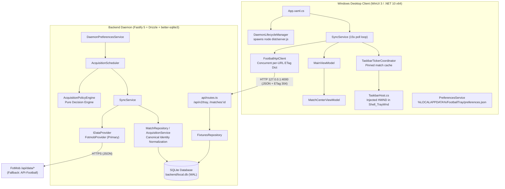
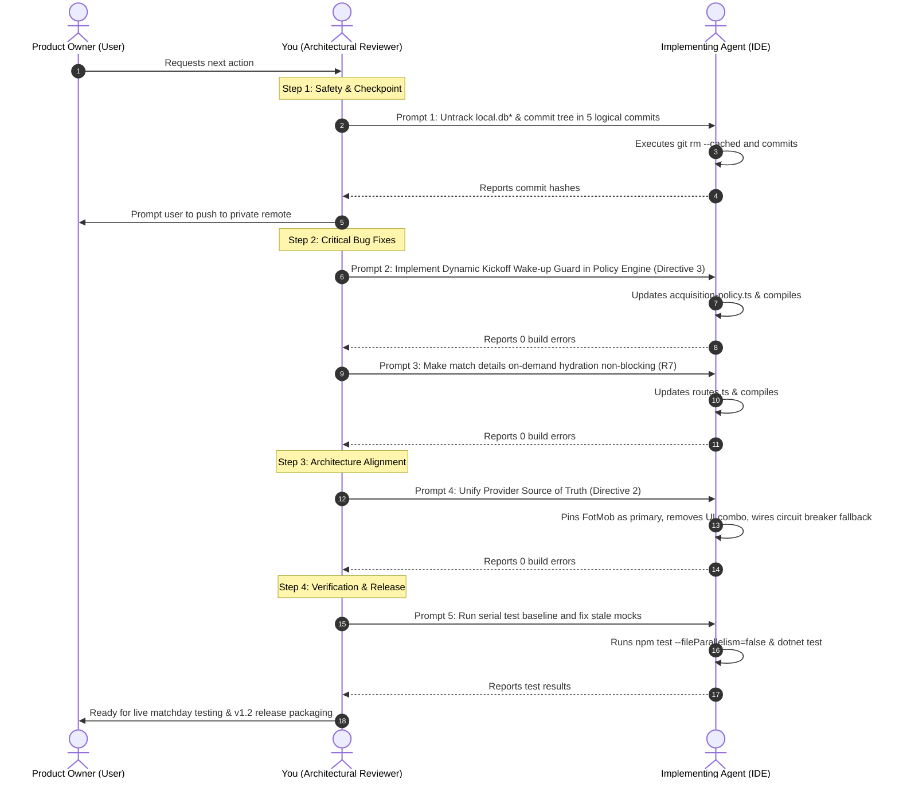

# FootballTray: Project Context & Architectural Review Handoff

> **Audience:** Incoming Co-Principal & Architectural Reviewer (AI Agent)  
> **Prepared:** 2026-10-19 (local, UTC+3) from direct codebase inspection & outgoing architectural alignment  
> **Your Role:** You are the **Co-Principal & Architectural Reviewer**. You collaborate directly with the Product Owner (the user) to turn high-level football and platform requirements into precise, bounded implementation instructions for the **Implementing Agent** (the coding agent working in the IDE terminal/editor). You review the implementing agent's work, enforce system invariants, and preserve architectural integrity. You do not edit code directly.

---

## 0. Executive Summary & Reviewer Baseline

- **Application:** Standalone Windows 11 football companion featuring a live score ticker docked directly inside the Windows taskbar (`Shell_TrayWnd`), paired with a WinUI 3 dashboard, Match Center, system toast notifications, and stadium audio cues.
- **Backend Service:** Autonomous Node.js/TypeScript background daemon (Fastify 5 + SQLite via better-sqlite3 + Drizzle ORM) spawned and managed by the desktop client. It handles provider ingestion, caching, and rate budgeting.
- **Current Release & Tag:** `v1.1.0` (commit `bac728f`, tagged 2026-09-25). Repository `VERSION` = `1.1.0`.
- **Current Stage:** **Post-v1.1.0 Stabilization & FotMob Provider Migration.** Moving away from the 100 req/day quota constraints of API-Football to FotMob's unmetered JSON feeds.
- **Git State:** `master` at HEAD commit `a1a0e6a` (2026-10-09). **46 modified + 18 untracked files (~+3,026 / −1,263 lines) currently reside uncommitted in the working tree.** No git remote is configured.
- **Status of Previous Review:** The 5 key architectural questions from our preliminary audit have been formally settled with the outgoing reviewer and Product Owner (see §10 & §12). The core operational directives are locked for the v1.2 milestone.

---

## 1. Product Overview & Feature Matrix

FootballTray is designed to deliver immediate, glanceable football telemetry without interrupting the user's desktop workflow:

| Feature Surface | Technical Mechanism | What the User Experiences |
|---|---|---|
| **Taskbar Ticker** | Win32 native HWND child docked into `Shell_TrayWnd` via [TaskbarHost.cs](file:///f:/Programs/FootballTray/src/client/FootballTray.Client/Taskbar/TaskbarHost.cs). | Compact 210px widget displaying club crests, 3-letter codes, live scores, and clock (`67'`, `45+2'`, `HT`, `FT`). Rotates through simultaneous live games; allows locking to a **pinned match**. |
| **Hover Micro-Flyout (Peek View)** | WinUI 3 XAML Flyout anchored to ticker HWND. | Hovering the ticker shows match status, goalscorers/minute, aggregate scores, and a pin toggle. |
| **Main Window (`MainPage`)** | WinUI 3 Window with custom NavigationView. | Calendar carousel locked to a strict 3-day window (`Yesterday / Today / Tomorrow`). Matches grouped by competition with country badges (ENG, ESP, INT…), search filter, and midnight rollover. |
| **Match Center Window** | Dedicated secondary window ([MatchCenterWindow.xaml](file:///f:/Programs/FootballTray/src/client/FootballTray.Client/Views/MatchCenterWindow.xaml)). | Real-time event timeline (goals, cards, substitutions with In/Out names), tactical pitch formation grid, head-to-head stat bars (shots, possession, xG), and two-legged aggregate badges. |
| **Settings & Catalog** | WinUI 3 Page ([SettingsPage.xaml](file:///f:/Programs/FootballTray/src/client/FootballTray.Client/Views/SettingsPage.xaml)). | Dynamic debounced catalog search for following clubs and leagues, notification lead time (0, 5, 15, 30, 60 min), sound mode selection, and System Diagnostics export. |
| **Audio & Notifications** | Windows App SDK toasts + `System.Media.SoundPlayer`. | Whistle on match kickoff, airhorn on goals, Toast notification deduplication to prevent duplicate alerts. |
| **Lifecycle & Resilience** | [DaemonLifecycleManager.cs](file:///f:/Programs/FootballTray/src/client/FootballTray.Client/Services/Daemon/DaemonLifecycleManager.cs) + [ExplorerRecovery.cs](file:///f:/Programs/FootballTray/src/client/FootballTray.Client/Taskbar/ExplorerRecovery.cs). | Client autonomously launches hidden `node dist/server.js`, terminates it on exit, survives Windows Explorer restarts, caches data offline in `%LOCALAPPDATA%\FootballTray\`, and polls with ETag / 304 Not Modified. |

---

## 2. System Architecture



### 2.1 WinUI 3 Desktop Client (`src/client`)
- **Runtime:** .NET 10.0 (`net10.0-windows10.0.26100.0`), Windows App SDK `2.4.0`, Unpackaged (`WindowsPackageType=None`).
- **Binary Footprint Optimization ("Strategy A2"):** Transitive AI/ML assemblies (`Microsoft.WindowsAppSDK.ML`, `Microsoft.WindowsAppSDK.AI`, `Microsoft.Windows.AI.MachineLearning`, `System.Numerics.Tensors`) are explicitly excluded, stripping ~40 MiB uncompressed from release payloads.
- **Taskbar Native Subsystem (`Taskbar/`):** Custom Win32 window classes (`FootballTray_MessageReceiver`, `FootballTray_Host`) find `Shell_TrayWnd`, calculate precise tray bounds across display scales and center/left taskbar alignments, and listen for `TaskbarCreated` messages to recover automatically from Explorer restarts.
- **Data Flow:** [SyncService.cs](file:///f:/Programs/FootballTray/src/client/FootballTray.Client/Services/SyncService.cs) queries `/api/v2/tray` on a 15-second timer. It supplies user preferences (followed team IDs, followed league IDs, and selected calendar date). It uses [FootballApiClient.cs](file:///f:/Programs/FootballTray/src/client/FootballTray.Client/Services/FootballApiClient.cs) with sorted query strings and a thread-safe `ConcurrentDictionary<string, string>` for per-URL ETags to receive HTTP 304 Not Modified when match state has not changed.

### 2.2 Backend Ingestion Daemon (`backend/`)
- **Runtime:** Node.js (ESM), TypeScript 5.7 strict, Fastify 5.
- **Database Layer:** Migrated from PostgreSQL to **strict local SQLite** using `better-sqlite3` configured with `WAL` journal mode, `foreign_keys = ON`, and `busy_timeout = 5000`. Persistence managed via Drizzle ORM.
- **Acquisition Cadences (Strike 24A Quota-Shield):**
  - **Pinned / Followed Live Burst:** Polls every 90 seconds while active games are in play.
  - **Unpinned Live Games:** 15-minute background polling.
  - **Idle / Off-Hours:** 4-hour polling interval.
  - **Schedule Discovery:** Twice-daily schedule fetch (00:00 & 12:00 UTC).
  - **Halftime Suspend:** 15-minute polling pause when active matches reach HT.
- **Canonical Identity System:** Eliminates third-party provider lock-in by generating immutable internal ULID identifiers (`ft_comp_*`, `ft_team_*`, `ft_fix_*`), mapped to external IDs via `*_provider_aliases` tables.

---

## 3. History, Milestones & Completed Work

| Milestone / Phase | Date Range | Scope & Deliverables Completed |
|---|---|---|
| **Phase 1: Scaffolding & Taskbar PoC** | 2026-09-01 | WinUI 3 solution structure, native Win32 `Shell_TrayWnd` HWND injection, provider-agnostic domain layer in `FootballTray.Core`. |
| **Phase 2 & 3: Ingestion & API-Football** | 2026-09-01 – 2026-09-05 | Acquisition policy engine, background scheduler, API-Football adapter, quota budgeting ledger, notification toasts, offline cache. |
| **Phase 4 & 5: Distribution & Updates** | 2026-09-09 – 2026-09-15 | Per-user installer (`scripts/install-client.ps1`), in-app auto-updater with SHA-256 verification, A2 payload optimization (−40 MiB), 60-min memory soak audit. Tagged `v1.0.1`–`v1.0.5`. |
| **Feature Release v1.1.0** | 2026-09-22 – 2026-09-25 | Tactical lineup visual pitch, H2H statistics, hover micro-flyout, pinned match state, search catalog, audio playback layer. Tagged **`v1.1.0`**. |
| **Architecture Modernization** | 2026-09-28 – 2026-10-02 | Client-managed Node daemon lifecycle, PostgreSQL completely purged in favor of SQLite, dynamic preferences sync, mock fallbacks removed. |
| **Stabilization & Polishing ("Strikes")** | 2026-10-03 – 2026-10-09 | Win32 Ole32 clipboard, midnight rollover, timezone filtering, strict 3-day calendar window, non-blocking on-demand sync (`a1a0e6a` = master HEAD). |

### 3.1 Work Completed Post-v1.1.0 (Uncommitted Working Tree)
Since the `a1a0e6a` commit, work has focused on the **FotMob provider migration** to escape external API quota limits:

1. **FotMob Ingestion Subsystem (`backend/src/providers/fotmob/`):**
   - Implemented [fotmob.provider.ts](file:///f:/Programs/FootballTray/backend/src/providers/fotmob/fotmob.provider.ts) targeting FotMob JSON data endpoints with circuit breaker protection.
   - Built resilient Zod schemas in `schemas/` with `.nullish()` on all nested statistics so missing pre-match stats do not discard lineups or event payloads.
   - Built heuristic 3-letter team acronym (TLA) generator with stopword filtering and common club overrides.
   - Built tactical formation parser mapping strings like `"4-2-3-1"` to pitch grid coordinates (`Row:Col`).
2. **October 14 Bug Batch (Backend Polish):**
   - Normalized parent fixture score and state updates during deep details sync.
   - Fixed competition country codes and primary league logos (`primaryId || id`).
   - Mapped substitution events (`swap[0]` / `swap[1]`) and card detail types, filtering non-incident markers.
   - Added weak ETag and HTTP 304 handling on `/api/v2/tray`.
3. **October 18 Bug Batch (Cross-Layer Fixes):**
   - **Substitution In/Out Swapped:** Aligned FotMob provider swap order with [MatchCenterViewModel.cs](file:///f:/Programs/FootballTray/src/client/FootballTray.Client/ViewModels/MatchCenterViewModel.cs) and added `AssistPlayerId` to [ApiContractDtos.cs](file:///f:/Programs/FootballTray/src/client/FootballTray.Core/Dto/ApiContractDtos.cs).
   - **Competition Country & Major Leagues:** Propagated real country codes instead of `'COMP'` across [acquisition.service.ts](file:///f:/Programs/FootballTray/backend/src/acquisition/acquisition.service.ts), [match.repository.ts](file:///f:/Programs/FootballTray/backend/src/repositories/match.repository.ts), and DTO formatters. Ingests all daily FotMob matches without league filtering.
   - **Taskbar Ticker Polish:** Enforced 3-letter short names, dynamic live clock formatting (`67'`, `45+2'`, `HT`, `FT`), and high-quality bilinear crest rendering (`DecodePixelType.Logical`, 36×36).
   - **Pin Preservation on Calendar Navigation:** Preserved `_pinnedMatch` in [TaskbarTickerCoordinator.cs](file:///f:/Programs/FootballTray/src/client/FootballTray.Client/Taskbar/TaskbarTickerCoordinator.cs) across date changes.
   - **Polling Flip-Flop Fix:** Built per-URL ETag caching and parameter sorting in [FootballApiClient.cs](file:///f:/Programs/FootballTray/src/client/FootballTray.Client/Services/FootballApiClient.cs) to eliminate competing query state.
4. **Build Status:** Both `npm run build` (backend TypeScript) and `dotnet build` (WinUI 3 Client) compile cleanly with **0 errors**.

---

## 4. Current Git State & Uncommitted Diff Analysis

```text
Branch: master
HEAD: a1a0e6a (2026-10-09 "fix(backend): remove blocking on-demand sync and quiet production logs")
Remote: None configured
Status: 46 modified files, 18 untracked files (+3,026 / −1,263 lines)
```

### Breakdown of Changed/Untracked Files
- **Backend Provider & Resilience (Untracked):** `fotmob.provider.ts`, `fotmob-provider.spec.ts`, `schemas/matches.schema.ts`, `schemas/match-details.schema.ts`, `circuit-breaker.ts`, `circuit-breaker.spec.ts`, `types.ts`, `errors.ts`, `provider.factory.ts`.
- **Backend Ingestion & Scheduling (Modified):** `acquisition-policy.ts`, `acquisition-scheduler.ts`, `acquisition.service.ts`, `sync.service.ts`, `daemon-preferences.service.ts`, `priority-competitions.ts`, `match.repository.ts`, `fixtures.repository.ts`.
- **Backend API & Schema (Modified):** `routes.ts`, `v2-dto.ts`, `envelope.ts`, `schema.ts`, `db/index.ts`, `provider-alias.ts`.
- **Client Services & ViewModels (Modified):** `FootballApiClient.cs`, `SyncService.cs`, `PreferencesService.cs`, `UserPreferences.cs`, `DaemonLifecycleManager.cs`, `TaskbarTicker.xaml.cs`, `TaskbarTickerCoordinator.cs`, `TrayTickerFormatter.cs`, `MainViewModel.cs`, `MatchCenterViewModel.cs`, `MatchItemViewModel.cs`, `SettingsPage.xaml(.cs)`.
- **Contract DTOs (Modified):** `ApiContractDtos.cs`.
- **Test Suites (Untracked/Modified):** `fotmob-details-hydration.test.ts`, `matchday-simulation.e2e.test.ts`, `database-injection-normalization.test.ts`, `tray-live-endpoint.test.ts`, `Phase8ClientConsumptionTests.cs`, `Phase10MatchCenterIntegrationTests.cs`.
- **Database Files (Tracked binaries - to be untracked):** `backend/local.db`, `backend/local.db-shm`, `backend/local.db-wal`.

---

## 5. Architectural Invariants & Review Findings

The architectural review identified 15 findings across the system. The outgoing reviewer and Product Owner have formally triaged these into the following action categories:

### Critical Architecture Deficiencies (Active Work Items)

1. **R1 — Uncommitted State on Unbacked Repository (Severity: High):** Over 3,000 lines of uncommitted code exist on local disk with no remote backup.
2. **R2 & R3 — Fragmented Provider Source of Truth & Hot-Swap Split Brain (Severity: High):**
   - The active provider is currently defined in 5 disparate locations: `UserPreferences.ActiveProvider`, `SettingsPage.xaml.cs`, `DaemonPreferencesService.ts`, `provider-factory.ts`, and `.env`.
   - Dynamic hot-swapping rebuilds the scheduler's `SyncService`, but `fastify.syncService` (which handles on-demand match hydration) continues running the initial provider instance.
   - *Resolution:* See Directive 2 in §10.
3. **R8 — Halftime Suspend Over-Sleep Hazard (Severity: Medium-High):**
   - In [acquisition-policy.ts](file:///f:/Programs/FootballTray/backend/src/acquisition/acquisition-policy.ts#L325-L335), when active matches enter HT, the policy returns `IDLE` for the full 15-minute window (`recommendedNextPollMs = 900,000`).
   - If other fixtures kick off during this window (e.g. 22:00 kickoff while a 21:00 match is in HT), the scheduler remains asleep and the kickoff is missed.
   - *Resolution:* See Directive 3 in §10.
4. **R7 — Awaited On-Demand Hydration in Route Handler (Severity: Medium):**
   - [routes.ts](file:///f:/Programs/FootballTray/backend/src/api/routes.ts#L457) awaits `syncFixtureDetails` inline during `GET /api/v2/matches/:id`. If the provider slows down, the client UI thread blocks. This regresses commit `a1a0e6a`.
   - *Resolution:* Shift on-demand hydration to background fire-and-forget or fast timeout, returning the existing SQLite record immediately.
5. **R13 — Tracked SQLite Runtime Binaries (Severity: Low-Medium):**
   - `backend/local.db` and its WAL files are tracked in git, generating constant noise.
   - *Resolution:* See Directive 4 in §10.

### Structural Debt Items (Deferred to Post-v1.2)
- **R4 (Duplicate Abstractions):** Two provider factories and two repository mapping paths (`MatchRepository` vs `FixturesRepository`/`AcquisitionService`).
- **R5 (Async SQLite Transaction Shim):** Wrapping synchronous SQLite in async transaction callbacks without explicit queuing.
- **R6 (Schema Drift):** Ad-hoc `ALTER TABLE` execution at startup in `db/index.ts` instead of versioned Drizzle migrations.
- **R12 (Stale Documentation):** Project docs (`DATABASE.md`, `README.md`) referencing PostgreSQL.

---

## 6. Working Agreement for the Incoming Reviewer

When drafting instructions for the implementing agent, adhere to the established conventions:

1. **Strict Execution Constraint:**
   - **NEVER** instruct the implementing agent to run `npm test`, `npx vitest`, or `dotnet test` during development cycles. Parallel test processes lock SQLite database files (`local_test.db`) and hang execution.
   - Require verification strictly using:
     ```pwsh
     # Backend verification
     cd backend ; npm run build

     # Client verification
     dotnet build src/client/FootballTray.Client/FootballTray.Client.csproj
     ```
   - Only execute tests when specifically orchestrating a dedicated, serial test baseline run (`npm test` with `--fileParallelism=false`).
2. **Prompt Construction Rules:**
   - Always structure instructions as numbered issues.
   - Include the exact file paths with GitHub markdown links.
   - Specify the observable symptom / error message, the root cause, the exact required code logic, and the completion verification command.
   - Explicitly instruct the agent: *"Do NOT make git commits until approved. Stop and report when build succeeds."*
3. **Execution Responsibility:**
   - The Product Owner personally runs and live-tests the application via `dotnet run`. The implementing agent only prepares builds.
   - When backend changes are made, remind the Product Owner that the backend must be rebuilt (`npm run build`) before launching the client, because the client spawns `backend/dist/server.js`.

---

## 7. Build, Run & Development Cheat-Sheet

```pwsh
# 1. Backend Build (TypeScript compilation to dist/)
cd backend
npm run build

# 2. Standalone Backend Development (with live reload)
npm run dev

# 3. Clean Database Reset (Destructive - re-runs seed script)
npm run db:force-reset

# 4. Client Build (WinUI 3 App)
dotnet build src/client/FootballTray.Client/FootballTray.Client.csproj

# 5. Client Execution (automatically spawns backend daemon)
dotnet run --project src/client/FootballTray.Client/FootballTray.Client.csproj

# 6. Official Release Packaging & Validation
pwsh -ExecutionPolicy Bypass -File ./scripts/publish-release.ps1 -Version "1.2.0"
pwsh -ExecutionPolicy Bypass -File ./scripts/validate-release.ps1
```

---

## 8. Test Suite Inventory

- **Backend Unit & Integration Tests (`backend/tests/`):** 34 Vitest suites covering acquisition policy, scheduler lifecycle, rate limit quota-shield, canonical ingestion, v2 contracts, ETag 304 semantics, and matchday simulation.
- **Client MSTest Suites (`tests/FootballTray.Client.Tests/`):** ~40 test classes covering ticker rotation, coordinate geometry, ETag regression, MainViewModel UI states, notification deduplication, preferences migration, and release packaging.
- **Current Operational Reality:** The full test suite has **not** been run since the FotMob migration began. Several tests still carry API-Football fixture shapes. A dedicated serial remediation pass is scheduled in Phase 2 of the roadmap.

---

## 9. Comprehensive Key File Index

| Component | Key Source Files |
|---|---|
| **Runtime & Lifecycles** | [app-runtime.ts](file:///f:/Programs/FootballTray/backend/src/runtime/app-runtime.ts) • [DaemonLifecycleManager.cs](file:///f:/Programs/FootballTray/src/client/FootballTray.Client/Services/Daemon/DaemonLifecycleManager.cs) • [App.xaml.cs](file:///f:/Programs/FootballTray/src/client/FootballTray.Client/App.xaml.cs) |
| **FotMob Provider** | [fotmob.provider.ts](file:///f:/Programs/FootballTray/backend/src/providers/fotmob/fotmob.provider.ts) • [matches.schema.ts](file:///f:/Programs/FootballTray/backend/src/providers/fotmob/schemas/matches.schema.ts) • [match-details.schema.ts](file:///f:/Programs/FootballTray/backend/src/providers/fotmob/schemas/match-details.schema.ts) |
| **API Endpoints & Contracts** | [routes.ts](file:///f:/Programs/FootballTray/backend/src/api/routes.ts) • [v2-dto.ts](file:///f:/Programs/FootballTray/backend/src/api/v2-dto.ts) • [envelope.ts](file:///f:/Programs/FootballTray/backend/src/api/envelope.ts) • [ApiContractDtos.cs](file:///f:/Programs/FootballTray/src/client/FootballTray.Core/Dto/ApiContractDtos.cs) |
| **Policy & Scheduler** | [acquisition-policy.ts](file:///f:/Programs/FootballTray/backend/src/acquisition/acquisition-policy.ts) • [acquisition-scheduler.ts](file:///f:/Programs/FootballTray/backend/src/acquisition/acquisition-scheduler.ts) • [sync.service.ts](file:///f:/Programs/FootballTray/backend/src/acquisition/sync.service.ts) • [daemon-preferences.service.ts](file:///f:/Programs/FootballTray/backend/src/acquisition/daemon-preferences.service.ts) |
| **Database & Identity** | [schema.ts](file:///f:/Programs/FootballTray/backend/src/db/schema.ts) • [db/index.ts](file:///f:/Programs/FootballTray/backend/src/db/index.ts) • [provider-alias.ts](file:///f:/Programs/FootballTray/backend/src/db/provider-alias.ts) • [fixtures.repository.ts](file:///f:/Programs/FootballTray/backend/src/repositories/fixtures.repository.ts) • [match.repository.ts](file:///f:/Programs/FootballTray/backend/src/repositories/match.repository.ts) |
| **Taskbar Native Host** | [TaskbarHost.cs](file:///f:/Programs/FootballTray/src/client/FootballTray.Client/Taskbar/TaskbarHost.cs) • [TaskbarTicker.xaml.cs](file:///f:/Programs/FootballTray/src/client/FootballTray.Client/Taskbar/TaskbarTicker.xaml.cs) • [TaskbarTickerCoordinator.cs](file:///f:/Programs/FootballTray/src/client/FootballTray.Client/Taskbar/TaskbarTickerCoordinator.cs) • [TrayTickerFormatter.cs](file:///f:/Programs/FootballTray/src/client/FootballTray.Client/Services/TrayTickerFormatter.cs) |
| **Client UI & ViewModels** | [MainViewModel.cs](file:///f:/Programs/FootballTray/src/client/FootballTray.Client/ViewModels/MainViewModel.cs) • [MatchCenterViewModel.cs](file:///f:/Programs/FootballTray/src/client/FootballTray.Client/ViewModels/MatchCenterViewModel.cs) • [SettingsPage.xaml.cs](file:///f:/Programs/FootballTray/src/client/FootballTray.Client/Views/SettingsPage.xaml.cs) • [FootballApiClient.cs](file:///f:/Programs/FootballTray/src/client/FootballTray.Client/Services/FootballApiClient.cs) |
| **Packaging & Release** | [RELEASE.md](file:///f:/Programs/FootballTray/RELEASE.md) • [publish-release.ps1](file:///f:/Programs/FootballTray/scripts/publish-release.ps1) • [validate-release.ps1](file:///f:/Programs/FootballTray/scripts/validate-release.ps1) |

---

## 10. Agreed Architectural Directives (Outgoing Alignment)

The outgoing reviewer and Product Owner have formally agreed upon the following 5 fundamental directives:

### Directive 1: Git Remote & Safety Checkpoint
- **Decision:** Secure the current working tree immediately before permitting the implementing agent to make any new functional changes.
- **Execution Plan:**
  1. Add `.gitignore` rules for runtime binaries (`local.db*`).
  2. Untrack existing SQLite binaries from the git index without deleting local files: `git rm --cached backend/local.db backend/local.db-shm backend/local.db-wal`.
  3. Stage and commit all changes into logical commits:
     - `feat(provider): implement FotMob provider, Zod schemas, and circuit breaker`
     - `feat(acquisition): integrate FotMob schedule ingestion and canonical mapping`
     - `feat(api): add v2 live tray routes, ETag caching, and detail normalization`
     - `feat(client): update taskbar ticker, pin caching, and substitution mapping`
     - `test: add FotMob integration, simulation, and contract test suites`
  4. Prompt the user to add a secure private git remote (`git remote add origin ...`) and push master.

### Directive 2: FotMob as Permanent Primary, API-Football as Strict Fallback
- **Decision:** FotMob is the permanent, authoritative primary football data provider.
- **Operational Model:**
  - Eliminate user-facing manual runtime provider hot-swapping from the UI, which creates severe split-brain states in the sync engine.
  - API-Football is relegated strictly to an automated, circuit-breaker-triggered fallback.
  - Fallback to API-Football engages **only** if FotMob experiences repeated consecutive HTTP/parsing errors and the circuit breaker trips to `OPEN`.
  - Establish a single source of truth: the daemon defaults to FotMob in all environments.

### Directive 3: Dynamic Kickoff Wake-up Guard in Halftime Suspend
- **Decision:** Eradicate the unconditional 15-minute sleep during halftime.
- **Execution Plan:**
  - In [acquisition-policy.ts](file:///f:/Programs/FootballTray/backend/src/acquisition/acquisition-policy.ts), when calculating `halftimeRemainingMs`, evaluate all known scheduled fixtures for the current day.
  - If any scheduled fixture has a kickoff time within the 15-minute window (`kickoffTime <= now + 15m`) or is overdue (`kickoffTime <= now`), clamp the sleep duration:
    $$\text{sleepDuration} = \min(15\text{m}, \max(30\text{s}, \text{kickoffTime} - \text{now}))$$
  - This guarantees the scheduler wakes up dynamically in time to capture kickoffs.

### Directive 4: Untrack SQLite Runtime Binaries
- **Decision:** Immediately remove SQLite database files from version control to prevent repository bloat, merge collisions, and binary churn.
- **Execution Plan:** Update [.gitignore](file:///f:/Programs/FootballTray/.gitignore) with `backend/*.db`, `backend/*.db-shm`, and `backend/*.db-wal`.

### Directive 5: Strict v1.2 Scope Boundary (Scope Freeze)
- **Decision:** v1.2 is defined strictly by the **stabilization, data integrity verification, and production release of the FotMob provider migration**.
- **Scope Boundary:**
  - **In Scope for v1.2:** Live bug batch verification, git baseline commitment, halftime wake-up guard, automated circuit-breaker fallback, serial test suite remediation, docs update (SQLite/FotMob), and release packaging.
  - **Out of Scope (Deferred to v1.3+):** League standings/tables views, player profile popups, secondary provider integrations, MSIX packaging, and database architecture rewrites.

---

## 11. Incoming Reviewer Action Plan: How to Orchestrate the Implementing Agent

As the incoming Architectural Reviewer, your immediate sequence of instructions to the implementing agent should follow this exact order:



### Detailed Steps for the Reviewer

1. **Phase 1: Securing the Repository Baseline (Immediate Priority)**
   - Issue **Prompt 1** to the implementing agent to update `.gitignore`, untrack `backend/local.db*`, and create 5 structured, conventional commits.
   - Advise the user to attach a private remote and push.
2. **Phase 2: Fixing Runtime Flaws (Directive 3 & Finding R7)**
   - Issue **Prompt 2** to update `acquisition-policy.ts` with the dynamic kickoff delta calculation so the scheduler never sleeps past a kickoff.
   - Issue **Prompt 3** to update `routes.ts` so `handleMatchDetails` returns the existing SQLite record immediately without blocking the client on third-party HTTP timeouts.
3. **Phase 3: Solidifying the Provider Hierarchy (Directive 2)**
   - Issue **Prompt 4** to clean up the provider selection split-brain: remove the experimental combo from `SettingsPage`, set FotMob as the default across all configs, and wire API-Football as a purely automated fallback when the FotMob circuit breaker opens.
4. **Phase 4: Test Suite Alignment & v1.2 Release**
   - Run a serial test pass (`npm test --fileParallelism=false`) and update test fixtures that still expect API-Football payload shapes.
   - Update `README.md`, `ROADMAP.md`, and `RELEASE.md` to document the SQLite + FotMob architecture.
   - Run `publish-release.ps1 -Version "1.2.0"` and `validate-release.ps1` to produce the official release bundle.
